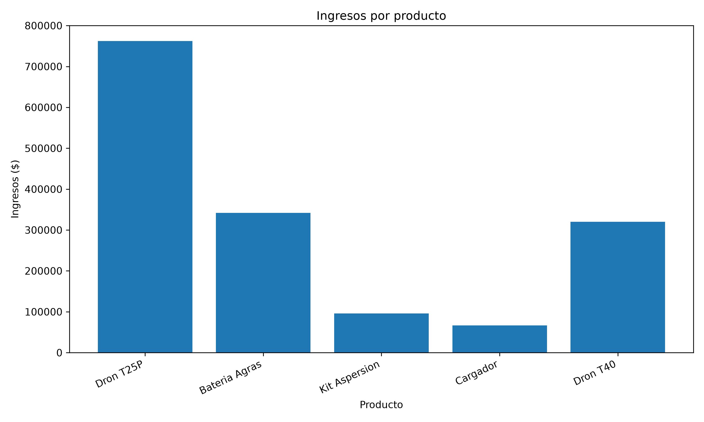
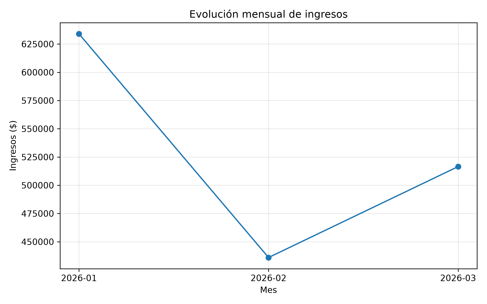
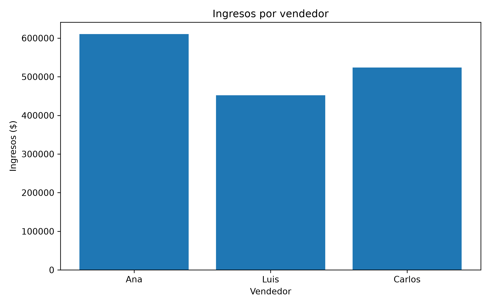

# Sales Data Analysis 

Proyecto de análisis de datos desarrollado con Python para transformar registros de ventas en indicadores comerciales y reportes visuales.

## Objetivo

Analizar el comportamiento de las ventas para identificar los productos con mayores ingresos, comparar el desempeño comercial por vendedor y evaluar la evolución mensual.

## Tecnologías utilizadas

- **Python:** procesamiento y análisis de datos.
- **CSV:** lectura de registros de ventas.
- **Pandas:** no utilizado en esta versión.
- **Matplotlib:** visualización de datos.
- **OpenPyXL:** generación de reportes de Excel.
- **Git y GitHub:** control de versiones y publicación del proyecto.

## Indicadores del análisis

- Ingresos totales registrados.
- Ingresos por producto.
- Ingresos y operaciones por vendedor.
- Unidades vendidas.
- Evolución mensual de los ingresos.
- Ranking de productos por ingresos.

## Resultados principales

El análisis se realizó con un conjunto de datos ficticios de 10 operaciones comerciales.

| Indicador | Resultado |
|---|---:|
| Ingresos registrados | $1,586,500 |
| Operaciones | 10 |
| Unidades vendidas | 38 |
| Producto con mayores ingresos | Dron T25P |
| Vendedor con mayores ingresos | Carlos |

Los ingresos representan el importe de las ventas, no la utilidad neta del negocio.

## Visualizaciones

### Ingresos por producto



### Evolución mensual de ingresos



### Ingresos por vendedor



## Estructura del proyecto

```text
sales-data-analysis/
├── data/
│   └── ventas.csv
├── reports/
│   ├── ingresos_por_producto.png
│   ├── ingresos_mensuales.png
│   └── ingresos_por_vendedor.png
├── analysis.py
├── requirements.txt
├── .gitignore
└── README.md
```

## Instalación y ejecución

Requisitos: Python 3.10 o superior.

1. Instalar las dependencias:

   ```bash
   python -m pip install -r requirements.txt
   ```

2. Ejecutar el análisis:

   ```bash
   python analysis.py
   ```

El programa procesa los datos y genera reportes CSV, Excel y gráficas dentro de la carpeta `reports/`.

## Datos

Los registros son ficticios y se utilizan exclusivamente con fines educativos y de demostración.

## Autor

**Carlos Villanueva**

Proyecto de portafolio orientado al análisis de datos, automatización de reportes y visualización de indicadores comerciales.